# RAGFlow-X 用户手册

> 适用版本：RAGFlow-X v0.5.0（迁移 v161 起）｜ 更新日期：2026-11-10 ｜ 截图环境：本地开发环境（示例数据）

本手册面向平台管理员、工作区管理员、业务运营人员和企业连接/审计协同人员。RAGFlow-X 通过安全治理、全生命周期知识体系和统一对话体验，消除企业生产需求与 RAGFlow 核心 RAG 引擎之间的 GAP；本手册说明登录、工作区治理、知识库管理、统一对话、模型接入、审批治理、RAGFlow 资源同步和日常运维。

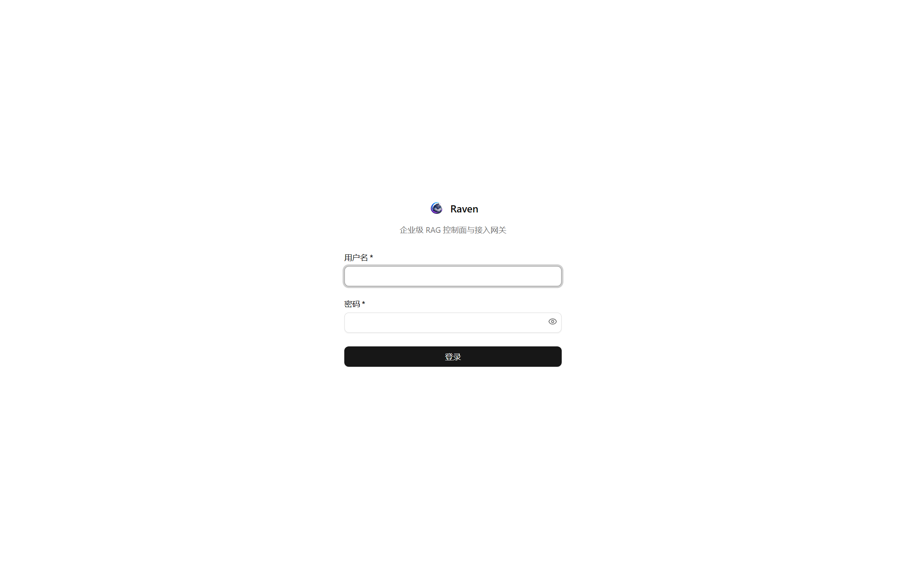

## 目录

1. [快速上手](#快速上手)
2. [角色与权限](#角色与权限)
3. [控制台总览](#控制台总览)
4. [组织治理](#组织治理)
5. [知识库与文档](#知识库与文档)
6. [对话与智能应用](#对话与智能应用)
7. [知识编译与企业记忆](#知识编译与企业记忆)
8. [模型与网关](#模型与网关)
9. [审批工作流](#审批工作流)
10. [审计与合规](#审计与合规)
11. [系统与运维](#系统与运维)
12. [常见问题](#常见问题)

---

## 快速上手

1. 打开 `http://<host>:5173/`。
2. 输入管理员分配的用户名和密码，点击 **登录**。
3. 进入仪表板后，先确认 **RAGFlow 引擎**、**DB**、**Redis**、**DocEngine** 状态。
4. 在 **数据集** 页面上传文档；系统会自动触发解析入库。
5. 在 **统一对话中心** 或 **问答工作台** 选择目标后提问。
6. 模型接入、企业连接、跨工作区变更或高风险操作如需审批，到 **审批中心** 提交并跟踪。
7. 如需迁移既有 RAGFlow 数据，先在 **系统 → RAGFlow 资源同步** 扫描、分配并显式导入。

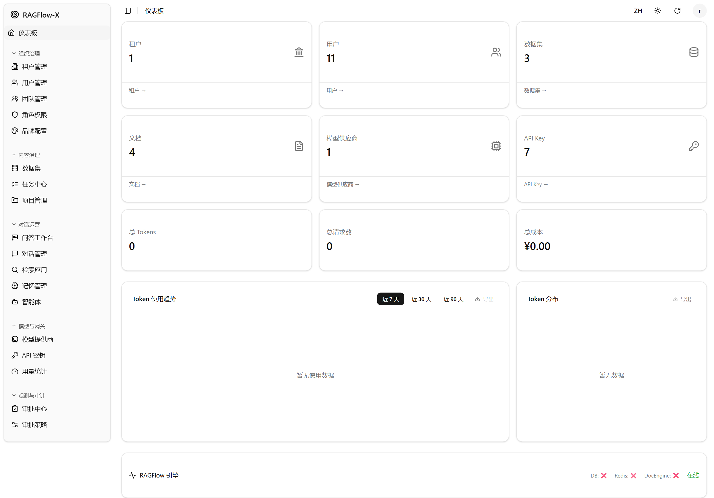

仪表板中的 **DB / Redis / DocEngine** 红叉表示对应组件不可用；`在线` 只代表 RAGFlow 引擎链路当前可达。生产环境应要求四项都为绿色或明确确认部署形态后再继续业务操作。

## 角色与权限

| 内置角色 | 典型职责 | 边界 |
|---|---|---|
| 平台管理员 `platform_admin` | 平台配置、工作区与角色治理、企业连接管理、跨工作区巡检 | 权限显式授权，不是通配符；目标工作区写入仍走治理授权和审批 |
| 工作区管理员 `tenant_admin` | 管理本工作区用户、团队、角色、数据集、模型、路由、API Key 和审批 | 不能管理系统、修复审计链或默认跨工作区写入 |
| 内容运营员 `operator` | 日常知识、任务、对话、检索应用、记忆、Agent 和知识运营 | 不管理系统、工作区、角色、品牌、模型、API Key 和审计 |
| 业务使用者 `business_user` | 通过统一工作台使用助手、检索应用和 Agent，可向既有数据集上传文档，并可删除本人上传的文档 | 不创建/修改数据集配置，不管理提示词、Agent Workflow、任务、模型、角色和工作区 |
| 只读访客 `viewer` | 查看授权业务资源和审批记录 | 无管理、执行和会话创建权限 |
| 团队管理员 `team_admin` | 管理本人负责团队及其绑定项目/数据集 | 不做工作区级治理，无模型、API Key、审计和审批权限 |

界面菜单按权限自动收缩。若某项菜单不可见，通常不是缺陷，而是当前账号没有对应资源权限。

## 控制台总览

控制台资源按业务域分组：

- **组织治理**：工作区、用户、团队、角色、品牌。
- **内容治理**：数据集、任务、项目。
- **对话运营**：问答工作台、对话管理、检索应用、记忆、智能体。
- **落地提效**：场景模板向导、知识运营看板、资产治理。资源路由分别为 `/scenario-templates`、`/knowledge-ops`、`/asset-governance`；若当前侧边栏未显示，可使用资源路径访问，菜单是否可见仍由权限控制。
- **模型与网关**：模型提供商、企业连接、API Key、用量统计。
- **观测与审计**：审批中心、审批策略、审计日志。
- **系统**：数据库、Redis、引擎、初始化、平台配置和 RAGFlow 资源同步。

顶部支持语言切换、主题切换、刷新和用户菜单。

## 组织治理

### 用户与团队

1. 进入 **组织治理 → 用户管理**。
2. 点击 **新建**，填写用户名、密码和角色。
3. 进入 **团队管理**，创建团队、指定负责人、添加成员。
4. 将用户加入对应团队，业务资源可按工作区/团队/个人授权。

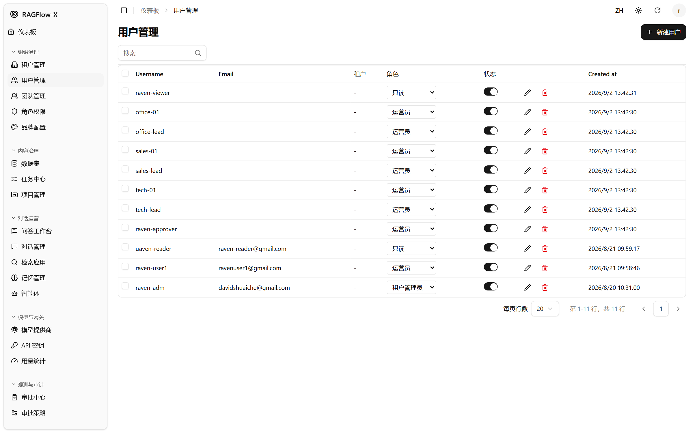

### 角色与品牌

- **角色权限**：按资源授权 `read`、`manage`、`execute` 等动作，建议遵循最小权限原则。
- **品牌配置**：可调整工作区级名称、Logo 和基础品牌展示。

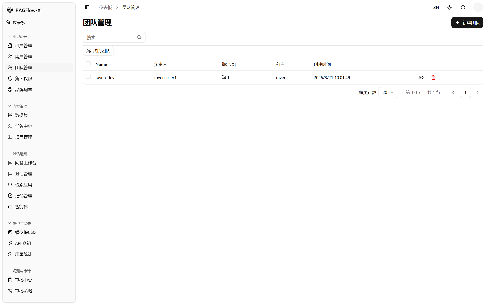

## 知识库与文档

### 创建与解析

1. 进入 **内容治理 → 数据集**，点击 **新建数据集**。
2. 填写名称、描述、权限范围、切分方式和 Embedding 模型。
3. 进入数据集详情，点击 **上传文档**。
4. 选择文档后上传；系统默认立即调用 RAGFlow 解析。
5. 观察 **解析状态**、**分块** 和 **令牌**。
6. 可对文档执行停止、启用/禁用、Chunk 预览、删除等操作；业务使用者只能删除本人上传且归属记录完整的文档。

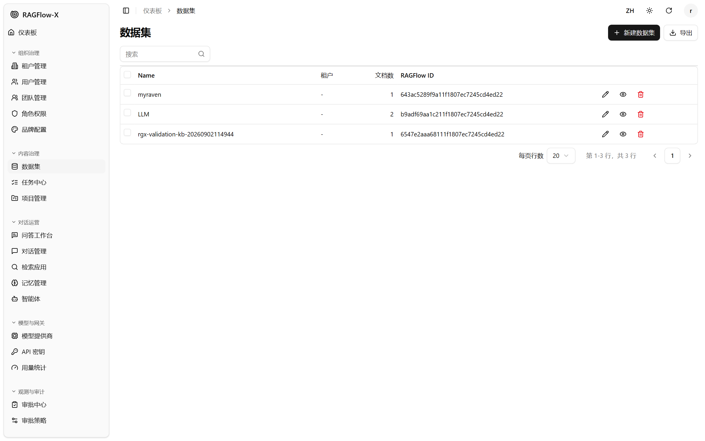

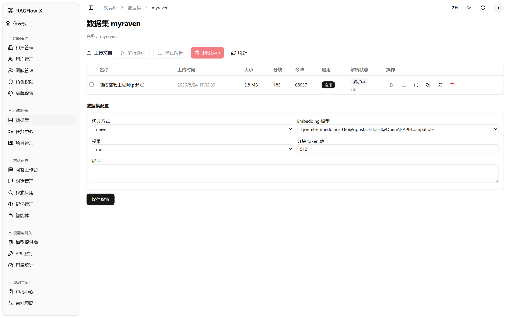

### 推荐配置

| 场景 | 建议 |
|---|---|
| 产品手册、FAQ | 使用较小 Chunk，关闭低质量重排，优先引用原文 |
| 法规、合同 | 使用按标题/条款切分，保留章节层级 |
| 多语言知识库 | 开启跨语言检索，统一 Embedding 模型 |
| 高频问答 | 先用小数据集验证命中率，再扩展全量语料 |

## 对话与智能应用

### 问答工作台

1. 进入 **对话运营 → 问答工作台**。
2. 选择 Chat 和数据范围。
3. 输入问题后发送，可查看流式答案、引用和反馈。
4. 对答案点赞/点踩，并可填写文字反馈。
5. 需要复查时跳转引用 Chunk，确认原文依据。
6. 在消息工具栏使用 **导出**，选择 Markdown、HTML 或 JSON。

统一对话体验适用于三个入口：

| 入口 | 位置 | 复用能力 |
|---|---|---|
| Chat | **问答工作台** | 流式回答、引用、反馈、导出 |
| Search App | **检索应用 → 详情 → 对话调试** | 流式回答、引用、工具过程、导出 |
| Agent | **智能体 → 详情 → 运行** | 流式回答、工具摘要、产物、导出 |

回答支持 Markdown、表格、代码块、Mermaid 图表和受白名单控制的结构化产物。导出的 Markdown/HTML/JSON 会尽量保留时间、模型、Token 和 `trace_id`；表格和图表产物可分别导出 CSV/PNG。问题驱动路由只给出推荐候选；默认建议模式不自动创建会话，自动低风险执行必须由管理员显式开启。

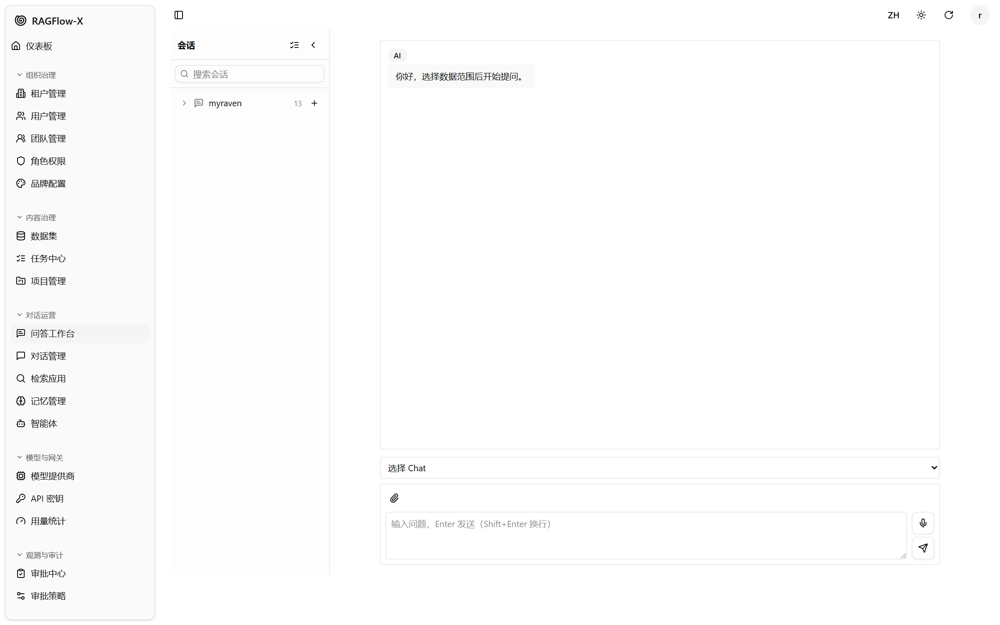

### 提示词与参数档位

Chat 和 Search App 支持提示词预设与参数档位，业务人员无需逐项调参：

| 档位 | 适用场景 |
|---|---|
| Safe | 制度、合规、合同等低风险输出 |
| Balanced | 常规业务问答 |
| Deep | 分析型问题、长上下文 |
| Citation-Strict | 审计、法务等要求结论可回溯的场景 |
| Speed | 高频 FAQ、低延迟短回答 |

预设包括企业知识问答、制度与员工助手、客服 FAQ、产品与设备手册、销售支持、合同与合规、IT 与运维、培训 Onboarding、财务与报表。选择预设后，系统会同步调整系统提示词、开场语、空答案话术、温度、Top N、相似度阈值和上下文长度建议。

### 场景模板与向导

打开 `/scenario-templates` 或按权限进入场景模板向导：

1. 选择业务场景，例如制度问答、客服 FAQ、合同合规、销售支持、IT 运维、培训或财务报表。
2. 选择生成 `Chat`、`Search App` 或 `Agent`；不同模板支持的应用类型不同。
3. 填写应用名称，绑定已解析的数据集。
4. 复核系统提示词、参数档位、示例问题、权限建议和发布检查项。
5. 创建后进入对应应用详情发布或试运行。

模板自带数据集建议、评测问题和验收提示，适合 30–60 分钟完成一个可试用的标准场景。模板是单一事实源：向导、试跑和发布评审读的是同一份模板版本，修改模板会生成不可变版本记录。

### 试跑（Trial Run）

试跑用于在不发布的前提下验证助手或场景模板配置：用当前配置真实跑一次检索与回答，并把结果、耗时和参数快照存档，供发布评审引用。

1. 在助手详情或场景模板向导点击 **试跑**，或调用 `POST /api/v1/trial-runs`。
2. 选择数据集与问题，确认模型与检索参数档位。
3. 结果页展示回答、引用、参数快照与 `policy_hash`；同一配置重复试跑应当得到相同快照，快照差异即为配置漂移。
4. 发布评审可引用试跑编号，作为“练过没练过”的证据；`GET /api/v1/trial-runs` 支持按助手/模板过滤。

**权限**：发起或取消试跑需要 `trial-run:execute`，读取结果需要 `trial-run:read`。试跑是独立资源，不再借用评测集执行权——团队管理员可对自己团队的模板发起试跑，只读访客只能查看。

**注意**：试跑会真实调用上游引擎与模型，慢环境下单次可能数十秒；失败会如实记为 `retrieval_failed`，不会用空结果冒充成功。

### 对话、检索应用与记忆

- **对话管理**：维护 Chat、Session、作者配置和用量。
- **检索应用**：配置检索范围、提示词和模型，测试检索效果。
- **记忆管理**：维护工作区/用户/会话级记忆内容与状态；策略、内容与遗忘的边界见 [知识编译与企业记忆](#知识编译与企业记忆)。
- **引用定位**：回答中的引用可展开查看命中切片、文档与页码，并跳转到对应产物段落；引用与回答一起进入导出快照，便于事后核对。

### 智能体

1. 进入 **对话运营 → 智能体**，点击 **新建智能体**。
2. 使用 **画布** 或 **JSON** 编辑工作流。
3. 配置 `Begin → Agent → Message` 等节点和内嵌检索 Tool。
4. 导入/导出 JSON 便于版本化交付。
5. 保存并按发布门禁通过后，再创建 Session 进行对话验证。

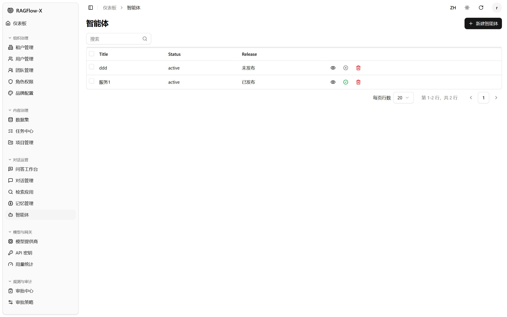

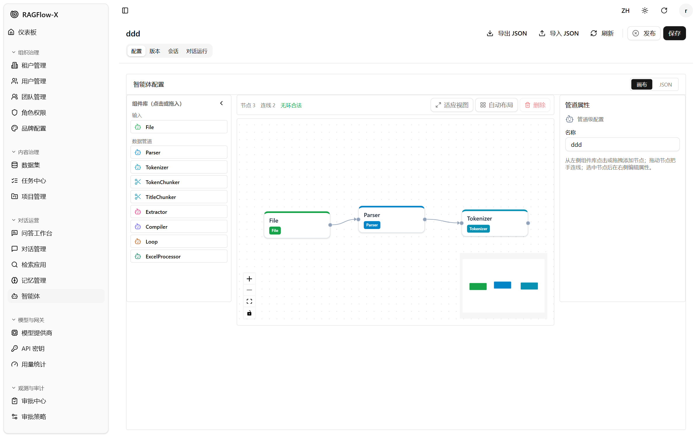

### 知识运营看板

打开 `/knowledge-ops`：

1. 选择近 7/30/90 天范围；如需精确口径，可使用 API 的 `date_from`/`date_to` 参数。
2. 查看总轮次、活跃用户、会话数、引用率、满意度、无答案率、失败率、平均延迟和坏例平均修复时长。
3. 查看 **Top 查询** 和 **Top 坏例**，判断知识缺口和模型/检索问题。
4. 对坏例执行 **标记修复**、**忽略**，或将其加入指定评测集。
5. 修复知识、提示词或数据集权限后，继续观察次日指标。

### 资产治理

打开 `/asset-governance`：

- **模板资产**：创建、编辑、导出、导入、归档模板；平台管理员可在治理授权下跨工作区复制。模板更新会生成不可变版本记录。
- **提示词策略**：设置工作区或应用级默认预设/档位；非活跃版本可回滚，历史版本可审计。
- **知识生命周期**：维护数据集负责人、负责团队、业务域、敏感级别、复审状态、到期时间和质量分。
- **评测集**：手动创建评测集，从模板批量生成评测集，或将知识运营坏例转为评测用例。

## 知识编译与企业记忆

### 知识编译

知识编译在解析完成后把文档编译成可核对的结构化产物（`wiki` 知识页），用于跨文档问答与引用回溯。它不是解析的替代品：解析负责切块入库，编译负责产出带出处的知识页。

1. 数据集详情页可看到编译入口与历史运行；也可调用 `POST /api/v1/datasets/:id/compilation/runs` 发起，`GET .../compilation/runs` 查看状态。
2. 编译按数据集配置的 **编译 Token 预算** 执行。预算过小会截断产物，过大则拖长运行时间；建议先用一份小文档验证链路再扩到全量。
3. 编译完成后用 `GET /api/v1/datasets/:id/artifacts` 查看产物：产物条目带渲染后的正文与来源切片 ID，可逐条核对引用。
4. 产物会被对话与检索命中，引用可定位到产物段落。
5. 产物类型在治理链路中以独立 kind 建模：`wiki` 为可消费产物，其它结构变体仅在引擎支持且已登记时才会暴露。

**引擎约束（重要）**：知识编译依赖上游引擎的编译能力。RAGFlow v1.0.0 上平台只暴露 `wiki` 一种可读产物 kind；历史 `page_index` 变体在 1.0 上会被入口拒绝并提示改用 `wiki`（错误码 `422/42261`），不会静默降级成“看起来成功但没有产物”。引擎版本不在已验证带内时，平台先要求跑契约复验再放行，而不是直接开着用。

### 企业记忆

企业记忆把对话中确认过的事实沉淀为可复用的记忆条目，分工作区 / 用户 / 会话三级：

- **策略**：工作区管理员设置记忆开关、可写范围与保留策略（`memory-policy`）。
- **内容**：业务使用者可读写与本人相关的记忆内容；内容运营员可管理工作区级内容；记忆写入本身是 `execute` 动作（`memory-write`）。
- **遗忘**：按条目或范围执行遗忘（`memory-forget`），执行后审计链留痕，遗忘不可回滚。
- **边界**：`viewer` 无记忆写入与遗忘权限；跨工作区读取记忆内容属于敏感治理读，不能通过普通 `memory:read` 绕过。

## 模型与网关

### 模型提供商

1. 进入 **模型与网关 → 模型提供商**，点击 **接入供应商**。
2. 接入向导将 **OpenAI-API-Compatible** 放在首位；企业私有部署通常优先选择该方式接入 vLLM、Ollama、Xinference、GPUStack 或其他 OpenAI 兼容服务。
3. 私有部署友好供应商在列表中优先排序，选项通过名称、说明和 Logo 辅助识别；长列表提供搜索、模型类型标签和滚动区域定位。
4. 填写名称、Base URL、API Key、实例和模型能力。保存前可使用连通性测试验证凭据与端点。
5. 平台管理员默认可跨工作区读取治理视图；创建或修改目标工作区资源仍受归属工作区、治理授权和审批策略约束。工作区管理员管理本工作区提供商与实例。

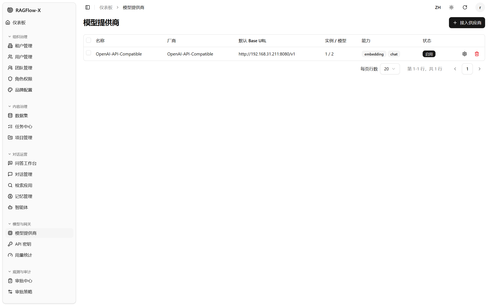

### API Key 与用量

- **API Key**：为工作区/用户生成调用凭证，可控制启用、过期、限流和月度 Token/请求预算。
- **用量统计**：查看 Token、请求数、日聚合与明细导出，用于治理和容量评估；本阶段不包含计费、账单或结算。

### 企业连接

1. 进入 **模型与网关 → 企业连接**，按 Provider、生命周期和归属工作区筛选。
2. 平台管理员可创建、修订、绑定、轮换凭证、弃用、退役并测试连接；工作区管理员可读取和测试归属连接。
3. 创建或修改敏感配置如命中审批策略，先在审批中心完成治理，再查看生效版本。
4. 大规模治理列表可使用 `cursor` 稳定分页；返回 `next_cursor` 和 `has_more`，避免深分页跳页导致漂移。

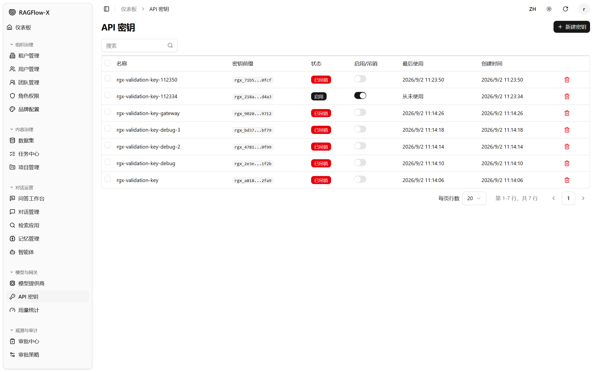

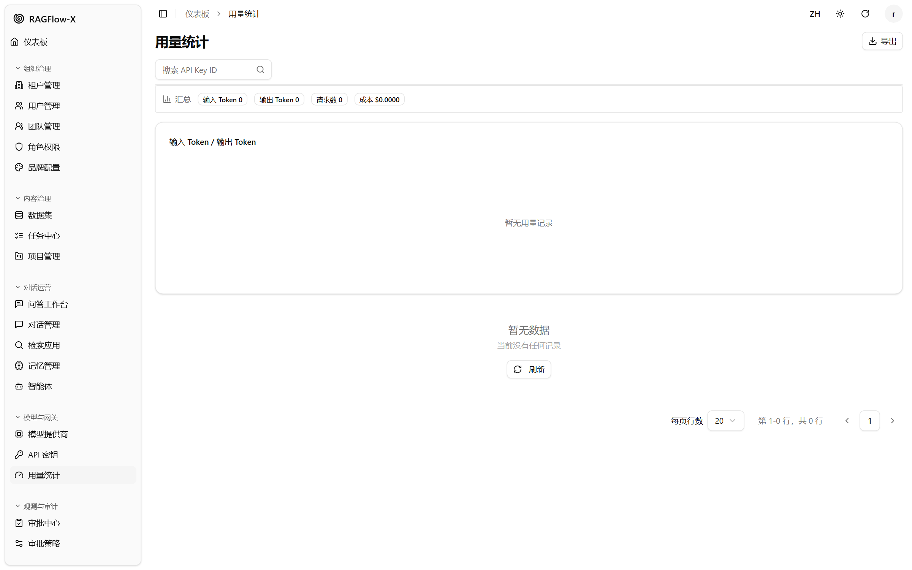

## 审批工作流

### 策略与审批

审批按 `对象类型 + 动作` 匹配策略。常用对象包括：

- `dataset`
- `dataset-config`
- `api-key`
- `model-provider`
- `model-instance`
- `model-model`
- `enterprise-connection`
- `enterprise-binding`

常见动作包括 `create`、`update`、`delete`、`revoke`、`bind`、`rotate-credential`、`deprecate`、`retire`、`test`、`parse`、`stop`、`enable` 和 `disable`。命中策略后，业务请求会先进入审批队列，不会直接修改 RAGFlow。

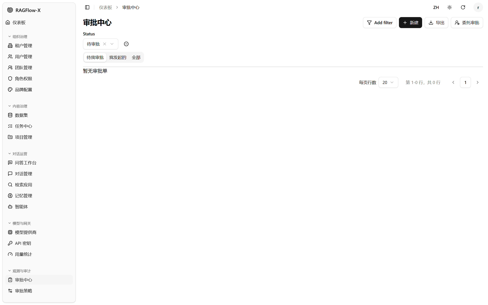

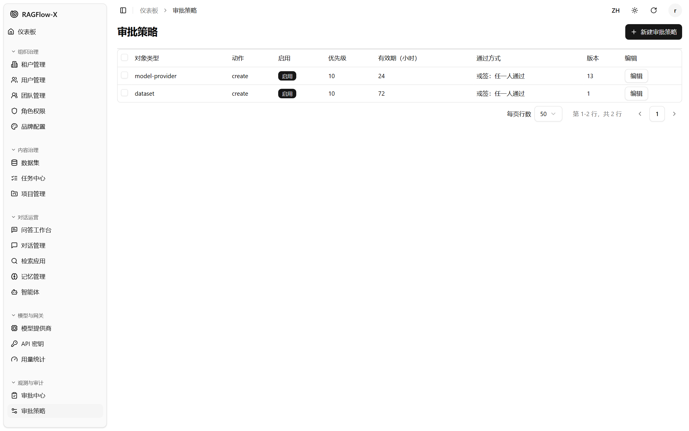

### 发起审批

1. 进入 **审批中心**，点击 **新建**。
2. 选择 **对象类型** 和 **动作**。
3. **对象 ID** 必填，用于精确定位待变更对象；界面提供“选择已有对象”。
4. 填写标题、申请原因；申请载荷可留空或按业务提示填写。
5. 点击 **提交审批**。

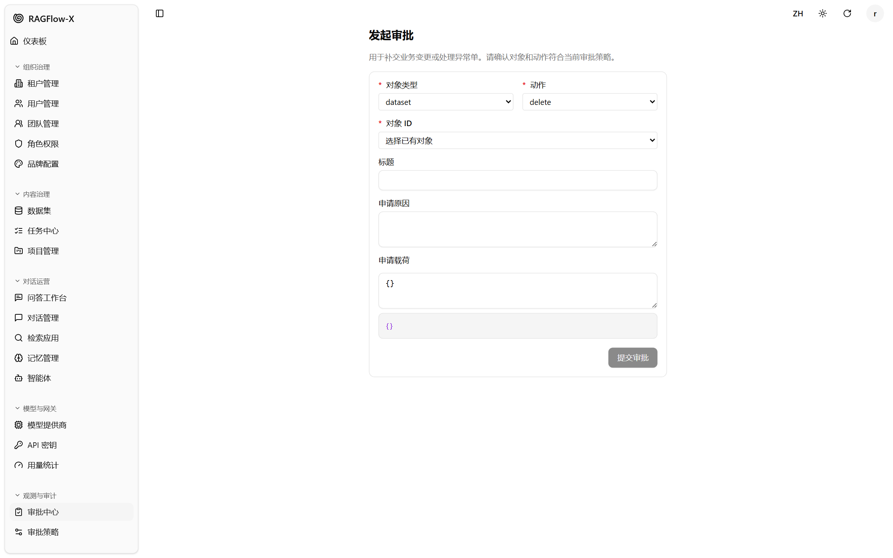

### 审批与异常处理

- **待我审批**：处理自己有权审批的单据。
- **我发起的**：查看本人提交的审批进度。
- **全部**：具备权限时查看工作区内全部审批。
- 支持通过、拒绝、取消、重试、导出和委托。
- 发起人与审批人应分离；跨工作区治理遵循目标工作区校验、职责分离和审批通道。请求方不能审批自己的单据。

## 审计与合规

### 审计日志

1. 进入 **观测与审计 → 审计日志**。
2. 使用操作者、动作、资源、时间范围、目标工作区、结果和审批 ID 筛选；界面对应 API 的 `target_tenant_id`、`result`、`approval_id`。
3. 点击眼睛图标查看详情、IP、Trace ID 和哈希。
4. 点击 **导出** 导出 CSV，点击 **校验** 检查审计链。

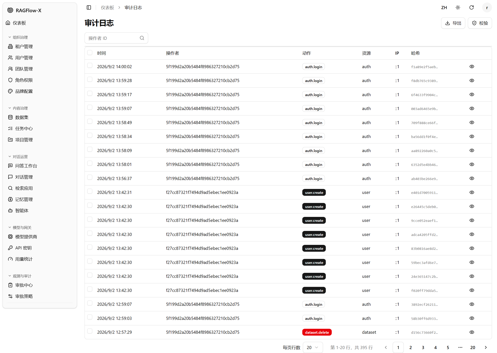

### 审计链修复

如 `校验` 返回 `valid=false`：

1. 不要手工修改数据库哈希。
2. 先备份 `rgx_audit_log`。
3. 由平台管理员调用 `POST /api/v1/audit/repair`，指定 API 字段 `tenant_id`。
4. 修复后再次校验并归档证据。

详见 [审计链备份与修复 SOP](./audit-chain-backup-and-repair-sop.md)。

## 系统与运维

### RAGFlow 资源同步

资源同步用于把既有全局 RAGFlow 实例中的 Dataset、Chat、Agent、Search App 和 Memory 纳入 RAGFlow-X 影子治理。当前版本只支持一个全局 RAGFlow 实例；同步是治理平面读取并建立 Binding，不是双向实时复制。

**权限**：需要 `ragflow-sync:read` 查看设置、Run、资源和版本；需要 `ragflow-sync:manage` 修改设置、扫描、分配、导入、Reconcile、Relink 和解决冲突。工作区管理员默认没有该权限。

**首次迁移建议**：

1. 进入 **系统** 页面，在顶部横向标签中选择 **RAGFlow 资源同步**，确认引擎健康，检查 `__GLOBAL__ → 目标工作区` 映射。
2. 在同一标签页中查看 **资源同步** 和 **RAGFlow 能力状态**；能力表使用绿色表示验证通过 / 运行正常，黄色表示未验证 / 未知，红色表示已废弃 / 异常。
3. 选择资源类型，启动 **扫描**。扫描只生成 `planned` Run，不会直接创建资源。
4. 打开 Run 明细，把计划项分配到目标工作区和 Owner。
5. 执行 **导入**。导入后的资源保持治理待审核：Chat / Agent Catalog 默认不可发现，Agent 默认不发布。
6. 检查 Plan / Result 报告；`conflict` 表示必须人工处理，`relink` 表示已有本地资源需要人工关联。

**定时 Reconciliation 建议**：默认关闭。大多数场景不需要持续实时同步；只有确实存在 RAGFlow 直连变更、历史数据补迁或 RAGFlow-X 暂未覆盖的操作时，才由平台管理员开启总开关与定时开关，并设置足够保守的间隔。关闭定时开关会取消排队中的定时任务；手动 Reconciliation 只受同步总开关控制。

**关键安全规则**：

- 导入不改变既有治理语义，Chat / Agent 不自动进入生产路由。
- Reconciliation 不执行物理删除；连续缺失只把 Binding 标记为 `missing` 并进入待处理。
- identity / mapping conflict 必须人工 Relink、映射复核或拒绝，不允许“以上游为准”自动覆盖。
- 扫描截断时 Run 标记为 `incomplete`，该轮不参与缺失确认。

同步的设计取舍与实施状态由工程团队的内部设计记录维护，不随本仓库发布；面向使用者的操作口径以本节为准。

### 生产配置

### 系统设置中心

系统设置中心用于管理审批、告警、观测、安全、网关和保留策略等运行参数。数值字段会显示允许范围，并提供滑动条和数字输入；无效或越界值会提示错误并阻止保存。部分结构性配置仍标记为“需要重启”，修改后会按实例上报生效状态。

生产环境建议：

1. 使用 PostgreSQL 和 Redis。
2. 通过 `config/config.production.example.yaml` 显式设置审批开关、过期、重试、提醒和保留窗口。多实例部署建议启用 Redis，以共享审批策略缓存；缓存读取失败时系统按无可用策略 fail-closed 处理。
3. 将真实凭据放在环境变量或 Secret，不写入仓库。
4. 开启结构化日志、Prometheus 指标和必要告警。

### 告警与配额

- **告警**：审批超期、发布门禁未过、编译失败、告警投递异常等事件汇集到 **系统与用量 → 告警**（`GET /api/v1/alerts`）；运维可标记已读、认领并手动重试失败的投递（`GET /api/v1/alerts/deliveries`、`POST /api/v1/alerts/:id/deliveries/:channel/retry`）。
- **配额与限流**：限流按租户 / 模型 / 助手多维桶计数；多实例部署时桶状态写入 Redis，避免每个副本各算一份。被限流的请求返回 `429` 并在响应头给出重试窗口，不会静默丢弃。
- **观测**：`GET /api/v1/system/settings/runtime/report` 与指标端点会给出配额命中、告警积压和编译任务状态，可作为日常巡检的取证入口。

### 日常巡检

| 检查项 | 频率 | 处理 |
|---|---|---|
| 引擎健康 | 每日 | 确认 DB、Redis、DocEngine、RAGFlow |
| 审计链校验 | 每周 | 异常时按 SOP 处理 |
| 审批待办 | 每日 | 清理超期单据 |
| 任务中心 | 每日 | 处理失败/停止任务 |
| 编译运行 | 启用知识编译时每日 | 检查失败/取消的运行与失败原因；回归前先做小样本重编 |
| RAGFlow 资源同步 | 启用定时对账时每日 | 检查 Run 报告、conflict 与 missing 待处理 |
| 告警与通知 | 每日 | 处理 OPEN 告警，确认投递终态不是长期 PENDING/RETRY |
| 用量与配额 | 每周 | 调整限流与配额 |
| 备份 | 每日 | 备份运营库与审计表 |

## 常见问题

### 登录后看不到菜单

该账号可能没有对应资源权限。请工作区管理员或平台管理员检查角色与权限。

### 登录失败提示混淆

| 状态/错误码 | 用户提示 | 处理 |
|---|---|---|
| `401/40101` | 用户名或密码错误 | 确认账号凭据；不要重复尝试触发限流 |
| `429` | 登录尝试过于频繁 | 等待限流窗口结束后再登录 |
| `403/40301` | 所属工作区已停用 | 联系平台管理员恢复工作区或调整归属 |
| `401`（无 `40101`） | 认证信息异常 | 清理失效 Token/Cookie 后重新登录 |

登录页提交 `/auth/login` 后不应自动调用 refresh 或 logout。若刷新后再次出现该链路，保存浏览器 Network 证据并反馈。

### 数据集解析长时间无变化

1. 检查任务中心状态。
2. 确认文档启用且解析未停止。
3. 确认 RAGFlow 引擎、Embedding 模型和任务队列健康。
4. 必要时停止任务后重试。

### RAGFlow 资源同步没有执行

1. 确认 **同步开关** 已开启；手动 Reconciliation 不要求定时开关。
2. 定时任务还要求 **定时 Reconciliation** 开启；仅开启同步开关不会排期。
3. 检查是否有 `pending`、`scanning`、`planned` 或 `running` Run；同一来源同一时刻只允许一个活动 Run。
4. 确认全局 RAGFlow 连接、API Key 和引擎健康。
5. 查看 Run 的 Plan / Result 报告；失败项使用明细定位后重试或人工处理。

### 资源同步显示 conflict

| 冲突类型 | 处理 |
|---|---|
| `identity` | 本地 Shadow 缺失或身份不一致；使用 Relink 或人工治理，不要自动覆盖 |
| `mapping` | 外部租户无法映射到有效目标工作区；先修正全局映射或默认目标 |
| `content` | 上游与本地内容同时变化；按业务选择处理路径并保留审计 |

### 问答没有引用或提示知识库未覆盖

1. 确认数据集已解析且文档启用。
2. 确认提问与语料语义一致。
3. 调整相似度阈值、Top N 和重排策略。
4. 检查 Embedding 模型是否与数据集一致。

### 提交审批后被挂起

这是策略命中后的预期行为。到审批中心等待审批，或联系审批人处理。

### 模型提供商无法修改

确认：

1. 当前账号具备 `model-provider:manage`。
2. 若使用平台管理员，确认目标工作区归属、治理授权和企业连接策略；跨工作区写入不是角色默认放行。
3. 该动作未命中审批策略；命中时需先完成审批。
4. 模型实例和 API Key 配置仍有效。

### 前端界面为空

1. 刷新页面。
2. 检查后端 `/api/v1/system/health`。
3. 确认登录 Cookie 或 Token 未过期。
4. 查看浏览器控制台和网络请求错误。

### 发起知识编译被拒绝

提示 `compilation kind ... is not supported by engine ...`（`422/42261`）时：当前引擎版本不支持所选产物类型。RAGFlow v1.0.0 上请改用 `wiki`；若确实需要结构变体产物，先确认引擎升级或等平台登记该 kind 后再切换，不要把拒绝当成“权限问题”。

### 试跑发起不了或看不到结果

- 能看结果但发不了：账号缺 `trial-run:execute`（试跑是创作动作，只读角色一律不持有）。
- 完全看不到试跑入口：缺 `trial-run:read`，或不在该助手/模板的可见范围。
- 试跑失败且原因为检索：先查数据集解析状态与引擎可达性；失败会被记成 `retrieval_failed`，需修复后重跑，不会自动降级为空回答。

### 检索很慢是网关问题还是引擎问题

用两个受控基线区分：`ragflow_provider_roundtrip`（网关→引擎往返）与 `qa_ragflow_chat`（端到端问答）。前者快、后者慢说明上游检索/模型慢，属于环境容量问题；两者同比例变慢才怀疑网关侧。不要在慢环境上把慢延迟当成功能缺陷，也不要据此判定试跑或发布门失败。

---

更多部署和实现细节见 [README](../../../README.md)、[内置角色权限矩阵](./permission-matrix.md)、[运维 Runbook 与故障演练 SOP](./operations-runbook-and-failure-drill-sop.md) 和 [审计链备份与修复 SOP](./audit-chain-backup-and-repair-sop.md)；工程内部设计记录（`doc/NNN` 编号）不随本仓库发布。
